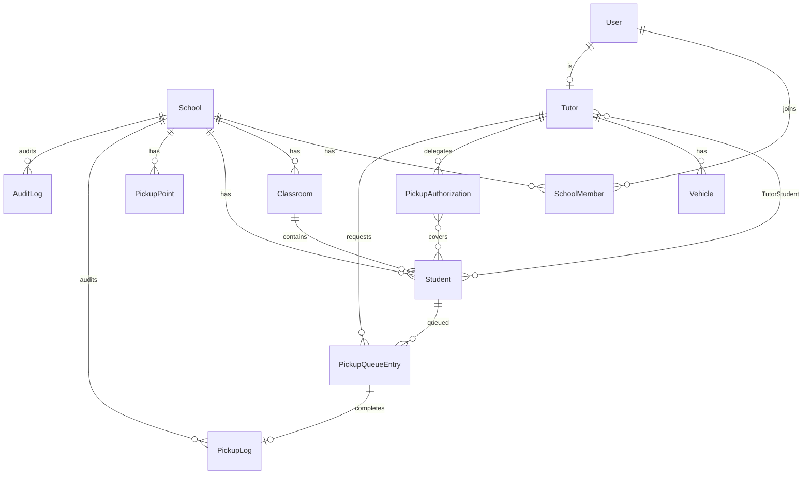

# 02 — Banco de dados

PostgreSQL + Prisma (`apps/api/prisma/schema.prisma`). Diagrama lógico:

## Multitenant — 3 camadas (defesa em profundidade)
1. **App**: `schoolId` vem do JWT (claim) / membro ativo, nunca do payload. Guard + interceptor injetam o escopo.
2. **Prisma**: extensão/client wrapper adiciona `where: { schoolId }` nas models tenant-scoped.
3. **Banco**: Row Level Security (`prisma/rls.sql`) com `app.current_school_id` por transação — vazamento entre escolas vira impossível mesmo com bug de query.

Estratégia: *shared database, shared schema, tenant column*. Não use schema-por-escola:
migração e pool viram pesadelo e o ganho de isolamento não compensa nesta escala.

## Auditoria imutável
`PickupLog`: cada retirada grava `prevHash` + `hash = SHA256(prevHash + payload canônico)`.
Alterar qualquer linha antiga quebra a cadeia — verificável por job/relatório.
Complemento: `REVOKE UPDATE, DELETE` para o usuário da aplicação (ver `rls.sql`).
`ConsentRecord` segue o mesmo padrão (LGPD art. 14): consentimento por finalidade é append-only
com hash encadeado; revogação é um novo registro `REVOKE`, nunca `UPDATE`/`DELETE`.

## Índices que importam no dia 1
- `PickupQueueEntry(schoolId, status, createdAt)` — fila da portaria
- `Student(schoolId, classroomId, status)` — painel do professor
- `PickupLog(schoolId, studentId, createdAt)` — histórico/relatório
- `TutorStudent(tutorId, studentId)` único — vínculo
